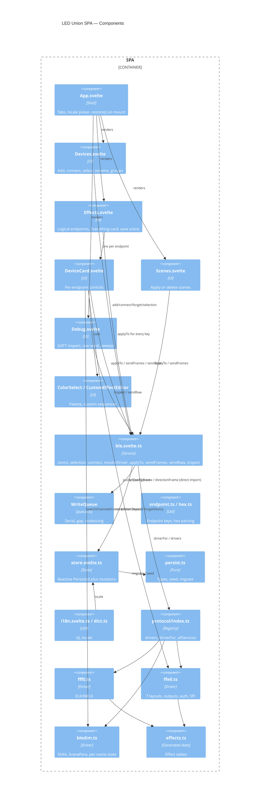

# C4 — Level 3: Components (SPA)

> Reversa Architect · 2026-10-24

## Notes
- 🟢 The UI imports family-specific helpers directly (`ffe0.spiConfigFrame`, `bledim.switchChannelsFrame`), outside the `Driver` interface. This leaks the abstraction; see debt TD-05.
- 🟢 `ble.svelte.ts` and `store.svelte.ts` are module singletons holding Svelte `$state`. There is no DI, so they cannot be tested without the Svelte runtime and Web Bluetooth mocks.
- 🟢 `persist.ts` was split out of the store specifically so it can be tested (commit `50de5fb`).
