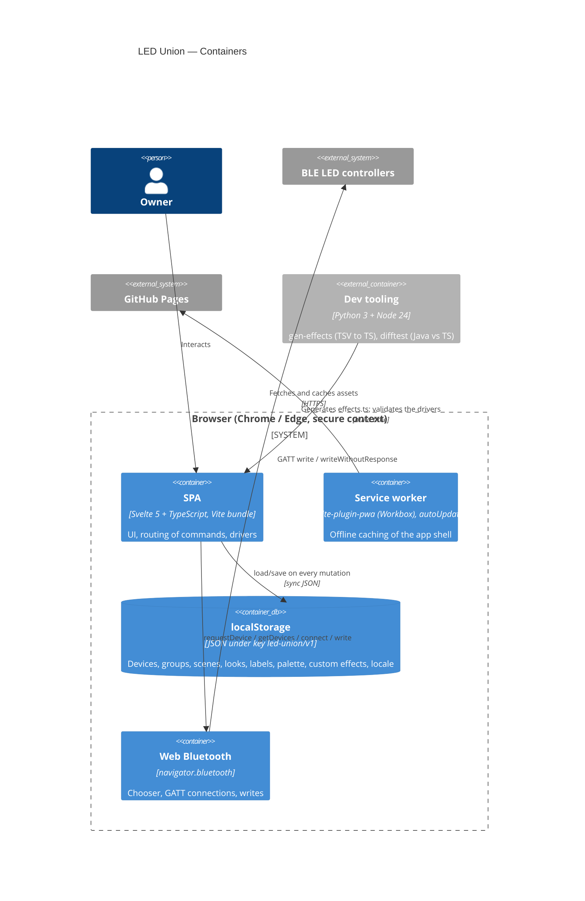

# C4 — Level 2: Containers

> Reversa Architect · 2026-10-24

| Container | Tech | Notes |
|---|---|---|
| SPA | Svelte 5.57 (runes), TS 6, Vite 8 | Single bundle; no router, tabs only |
| Service worker | vite-plugin-pwa 1.3 | `registerType: autoUpdate`; manifest: standalone, portrait, relative `start_url` |
| localStorage | browser | Single document, rewritten on every save; legacy key `led-onion/v1` |
| Web Bluetooth | browser | `@types/web-bluetooth`; `getDevices` optional |
| Dev tooling | Python stdlib, Node `--test` | Not shipped |
