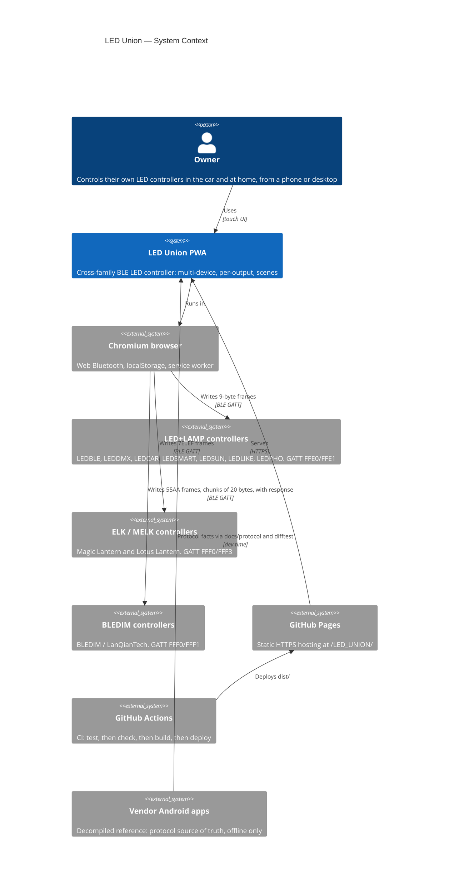

# C4 — Level 1: System Context

> Reversa Architect · 2026-10-24 · 🟢 unless marked

## Actors
| Actor | Role |
|---|---|
| Owner | The only persona. No accounts and no roles (see `permissions.md`) |
| LED controllers | Passive BLE peripherals. **No state is ever read back**; the app only writes |
| Vendor apps | Dev-time reference only (decompiled or memory-dumped); never contacted at runtime |
