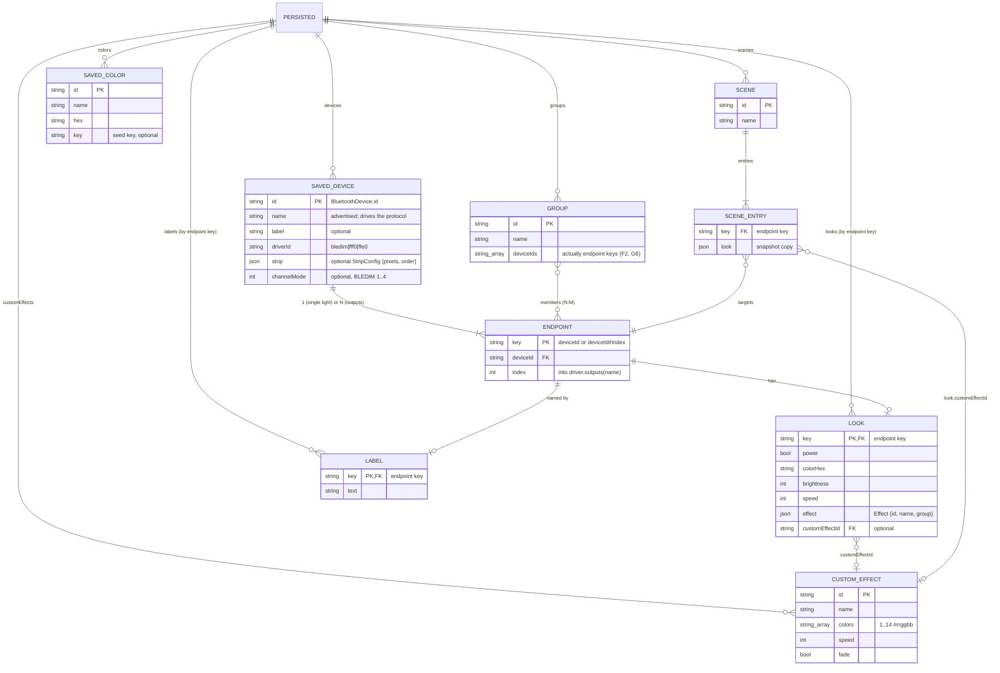

# ERD — LED UNION (localStorage document)

> Reversa Architect · 2026-10-24 · There is no database: a single JSON document `Persisted` lives in `localStorage['led-union/v1']`. The "relations" are string references, with **no referential integrity**; integrity is kept by hand in `forgetDevice` and `removeCustomEffect`.

## Cardinalities and integrity
| Relation | Card. | Kept by | Gap |
|---|---|---|---|
| Device → Endpoint | 1 : 1..N | derived from `driver.outputs(name)`, not stored | 🟢 |
| Endpoint → Look / Label | 1 : 0..1 | `forgetDevice` deletes `id`, `id#*` | 🟢 |
| Group ↔ Endpoint | N : M | `forgetDevice` removes only the exact `id` | 🟢 F2: `id#i` keys are orphaned |
| Scene → Entry → Endpoint | 1 : N, N : 1 | `forgetDevice` prunes entries and empty scenes | 🟢 |
| Look → CustomEffect | N : 0..1 | `removeCustomEffect` clears the looks | 🟢 **Scene entries are not cleared**: a deleted custom effect stays in the scene snapshot and is skipped silently on apply |
| SavedColor | standalone | Looks store the hex, not the id | 🟢 Deleting a colour never breaks a look |

## Runtime (non-persisted)
| Entity | Key | Notes |
|---|---|---|
| Conn | device id | `$state`; state machine SM-1 |
| Live | device id | device, char, WriteQueue |
| Selection | – | endpoint keys |
| BledimDeviceState | **advertised name** | F3 |
