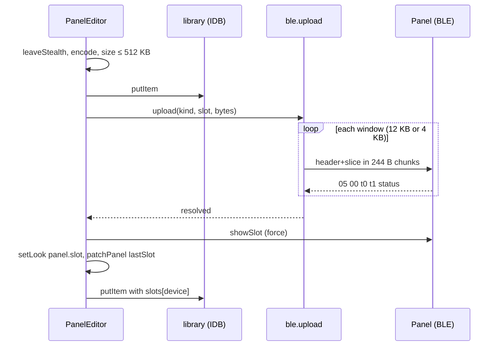

# Panel Content, Design

> Reversa Writer (incremental re-extraction) · 2026-11-01 · unit `panel-content`

## Components 🟢
| Component | File | Role |
|---|---|---|
| Panel view | `ui/Panel.svelte` | Device picker, library grid, imports, GIPHY, share intake |
| Editor | `ui/PanelEditor.svelte` | Preview, settings, slot, send/cancel, save |
| Renderer | `panel/render.ts` | Canvas fit, GIF decode, PNG/GIF encode, text raster |
| Library | `panel/library.ts` | IndexedDB CRUD, `StorageFull` |
| GIPHY client | `panel/giphy.ts` | Search URL, error mapping, hit selection |
| Upload bytes | `protocol/ipixel-content.ts` | Windows, CRC, ACK parse, text payload (pure) |
| Upload I/O | `ble.svelte.ts#upload` | Queue op, ACK waiters, progress, abort |
| Share intake | `public/share-target.js` | SW fetch handler → Cache → redirect |

## Send sequence 🟢

## Decisions 🟢
- Render state with a token so a stale async render never overwrites a newer one.
- `{#key editing.id}` remounts the editor per item.
- Share detection by the `x-name` header (files), not MIME.
- ImageDecoder always told `image/gif` (shared files may lack a type).
- See `_reversa_forward/002-ipixel-conteudo/roadmap.md` D1–D17.

## Known limits
- 🟡 Last-window ACK `01` accepted as done (architecture TD-16).
- 🟢 Text preview shows the first screen only (TD-17).
