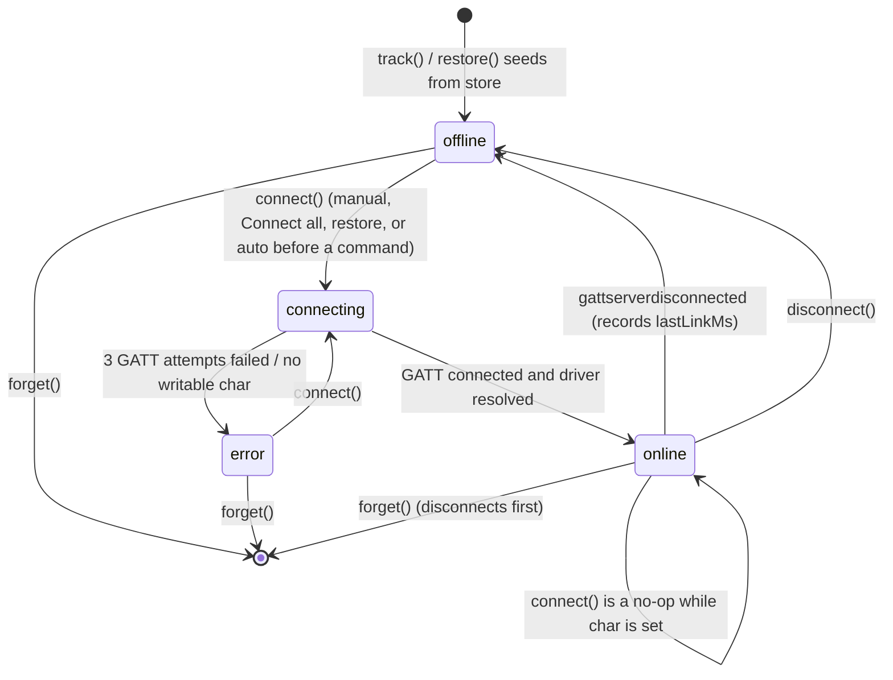
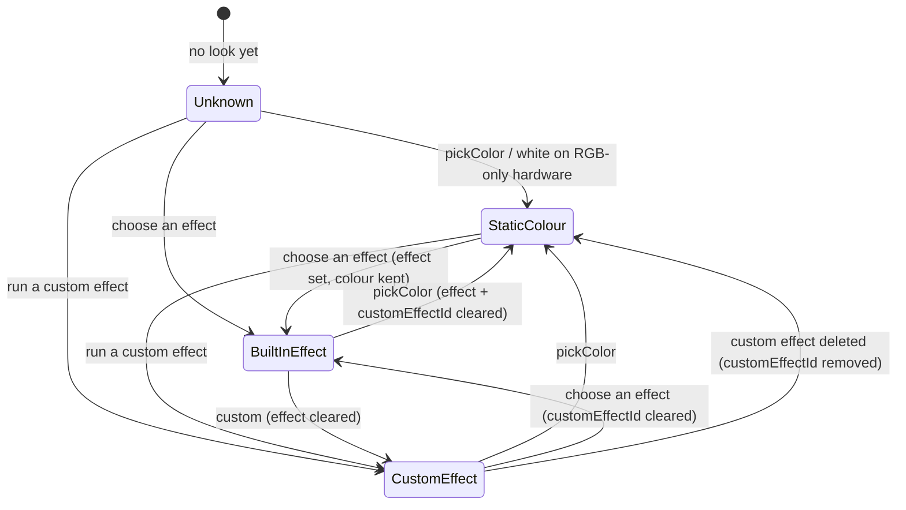
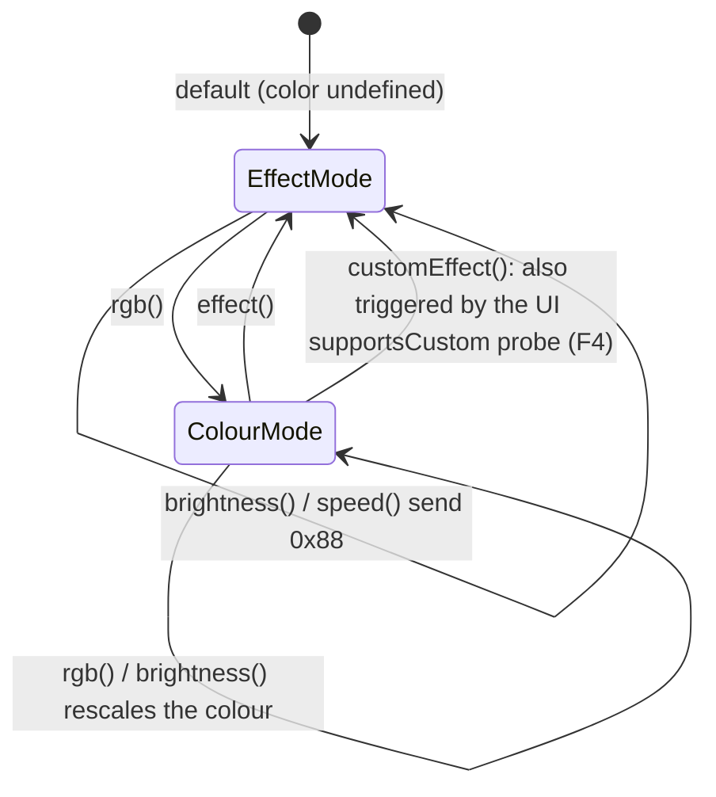
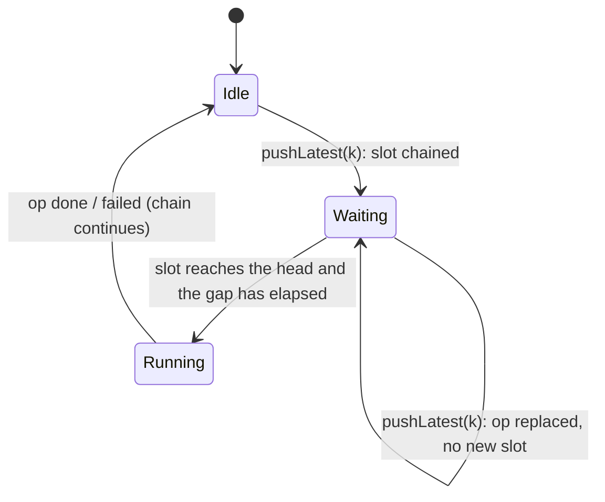

# State Machines — LED UNION

> Reversa Detective · 2026-10-24

## SM-1 Connection state (`Conn.state`) 🟢
Values: `offline | connecting | online | error`. Source: `src/lib/ble.svelte.ts`.

| Transition | Trigger | Side effects |
|---|---|---|
| → connecting | `connect(id)` | `error` cleared |
| connecting → online | `resolveDriver` ok | driver/queue may be swapped; `onConnect` handshake queued **after** state = online 🟢 |
| connecting → error | exception | `error = explain(e)`; rethrown |
| online → offline | device drop | `lastLinkMs = now - connectedAt`; `live.char` cleared |

Notes:
- 🟡 Handshake frames are queued after the state goes online, so a command racing the handshake goes through the same queue. The order is preserved, because the queue is FIFO.
- 🟢 `disconnect()` sets `offline` synchronously. The `gattserverdisconnected` event later sets it again; this is idempotent.
- 🟢 There is no `error → offline` transition except via a drop event.

## SM-2 Look / endpoint "mode" 🟢 (derived)
`Look` has no status field. Which mode an endpoint is in follows from which fields are set. Source: `DeviceCard.svelte`, `Effects.svelte`, `Scenes.svelte`.

Orthogonal fields: `power`, `brightness` and `speed` are updated independently.
- 🟡 Choosing an effect keeps `colorHex`, so the card still shows the colour swatch while an effect plays.
- 🟢 Real-white, CCT and sound changes do not touch the look (F5).

## SM-3 BLEDIM driver memory (`DeviceState.color`) 🟢
Source: `src/lib/protocol/bledim.ts`.

- 🟢 `white()` does **not** change `color`, so after a white change, brightness rescales the *previous* RGB colour. 🟡 This is probably unintended.
- 🟢 The state is keyed by advertised name (F3).

## SM-4 WriteQueue slot (per coalescing key) 🟢

## SM-5 UI panels (minor) 🟢
- `Devices`: `editing` (rename device) and `editingOut` (rename output) toggles; `busy` while adding or connecting all.
- `ColorSelect`: `creating` (picker open), Cancel restores `before`.
- `CustomEffectEditor`: new or editing (`editingId`); Save calls `reset()` and closes.
- `Scenes`: `busy = sceneId` while applying, so a second click is blocked for that scene only.
